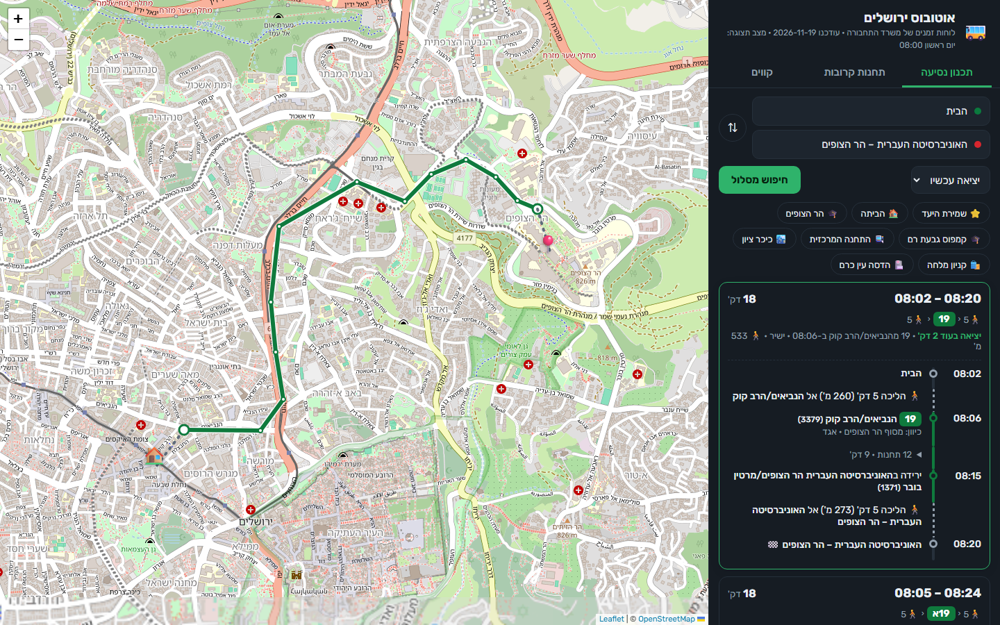
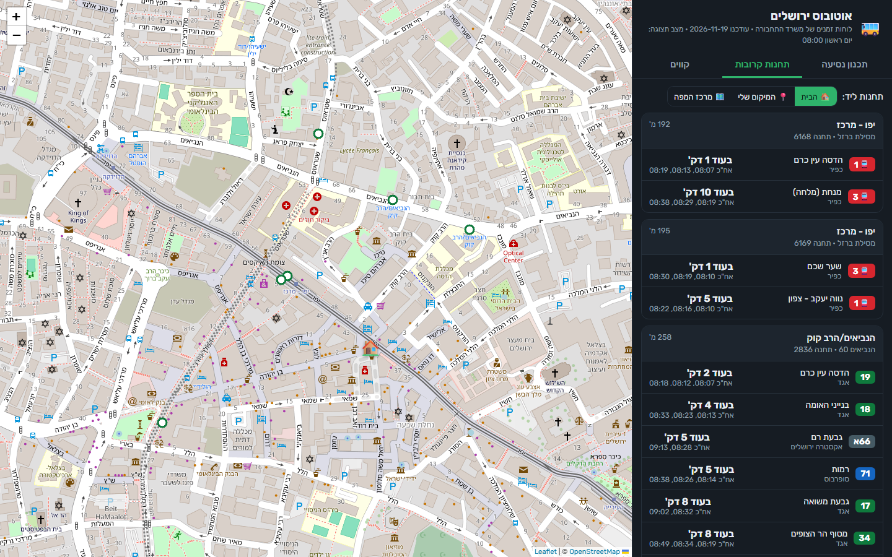
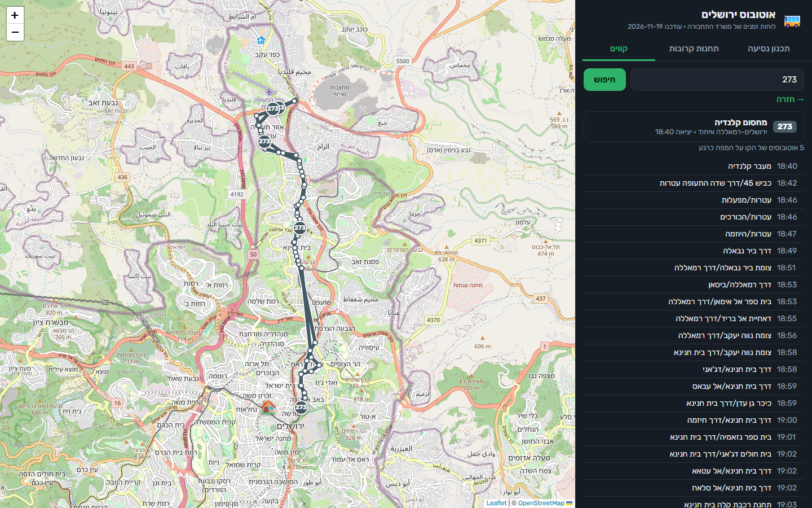
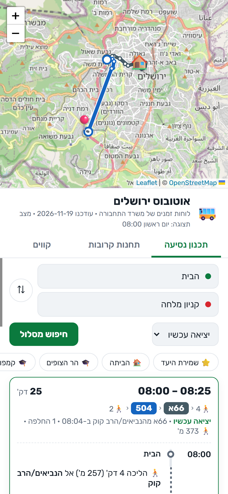
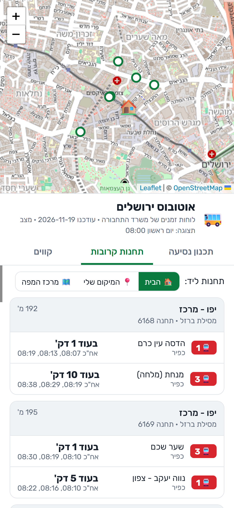

# אוטובוס ירושלים 🚌

אפליקציה לתכנון נסיעות באוטובוס וברכבת הקלה בירושלים, בסגנון Moovit. היא רצה מקומית על המחשב, על לוחות הזמנים הרשמיים של משרד התחבורה ועל מיקומי האוטובוסים בזמן אמת.

📄 **[על הפרויקט: הבעיה, תהליך העבודה מול המודל, הנתונים והפרטיות](docs/PROJECT.md)**

## צילומי מסך

| לוח יציאות מהתחנות הקרובות | אוטובוסים בזמן אמת על קו |
|---|---|
|  |  |

| בטלפון: תכנון נסיעה | בטלפון: תחנות קרובות |
|---|---|
|  |  |

צילומי המסך צולמו ב"מצב תצוגה" של יום ראשון בשעה 08:00, חוץ מצילום הזמן האמת, שצולם ביום שישי בערב. בתמונות הבית מוגדר במרכז העיר.

## מה יש באפליקציה
- **תכנון נסיעה**: בוחרים יעד מתוך מקומות שמורים, שם תחנה, כתובת או נקודה על המפה. האפליקציה מציגה כמה מסלולים, כולל זמני הליכה, החלפות ורשימת התחנות. אפשר לתכנן "יציאה עכשיו" או לשעה אחרת.
- **תחנות קרובות**: לוח יציאות מהתחנות ליד הבית, ליד המיקום הנוכחי או ליד מרכז המפה. לחיצה על קו מציגה את המסלול שלו ואת האוטובוסים שנמצאים עליו כרגע.
- **קווים**: מחפשים מספר קו ורואים את המסלול ואת זמני ההגעה לכל תחנה.
- **זמן אמת**: מיקום האוטובוסים מגיע מ-Open Bus של הסדנא לידע ציבורי ומתעדכן כל 30 שניות, עם הערכה של האיחור. הנתונים מגיעים בעיכוב של כ-3–5 דקות.
- בשבת ובלילה האפליקציה מציינת שאין שירות ומציגה את הנסיעות הראשונות שאחרי.

## הפעלה
דרישות: Windows, ו-Python 3.10 ומעלה.

לחיצה כפולה על **`הפעלה.bat`**. בפעם הראשונה הקובץ מוריד את לוחות הזמנים של משרד התחבורה (כ-140MB) ובונה מהם מסד נתונים של ירושלים, וזה לוקח כדקה. אחר כך הדפדפן נפתח בכתובת http://localhost:8765.
החלון השחור צריך להישאר פתוח כל עוד משתמשים באפליקציה.

## הגדרת הבית
מעתיקים את `config.example.json` לקובץ חדש בשם `config.local.json` וכותבים בו את הכתובת והקואורדינטות של הבית.
הקובץ הזה נשאר רק במחשב שלכם ולא עולה ל-git. בלי הקובץ, הבית מוגדר במרכז העיר, ואפשר לגרור את 🏠 על המפה למקום הנכון. המיקום נשמר בדפדפן.

## טיפים
- ⭐ "שמירת היעד" מוסיפה את היעד הנוכחי לכפתורי הקיצור.
- **מצב תצוגה**: מוסיפים לכתובת `?time=2026-11-22T08:00` והאפליקציה מציגה את לוח הזמנים כאילו זו השעה עכשיו. זה שימושי בשבת.
- **קישורים ישירים**: `?to=31.7929,35.2440,הר הצופים` פותח תכנון נסיעה ליעד, `?tab=near` פותח את התחנות הקרובות, ו-`?line=18` פותח קו.

## עדכון לוחות זמנים
משרד התחבורה מעדכן את לוחות הזמנים כל כמה ימים, והקובץ שהורד תקף כחודש. כדאי להריץ את **`עדכון לוחות זמנים.bat`** פעם בשבוע-שבועיים, כשהשרת סגור. כשהנתונים עומדים לפוג, האפליקציה מציגה אזהרה.
הקובץ הגולמי נשמר מחוץ לתיקיית הפרויקט, ב-`%LOCALAPPDATA%\jlm-bus`.

## איך זה עובד
| קובץ | תפקיד |
|---|---|
| `build_data.py` | מוריד את ה-GTFS של משרד התחבורה ומסנן לירושלים, לתוך `data/jerusalem.db` (SQLite, כ-85MB, לא נשמר ב-git) |
| `server.py` | שרת מקומי בלי חבילות חיצוניות: אלגוריתם תכנון מסלולים (Connection Scan), לוח יציאות וזמן אמת |
| `static/` | הממשק: מפה (Leaflet + OpenStreetMap), עברית מימין לשמאל, מותאם לטלפון ולמצב כהה |

**תכנון המסלול:** האלגוריתם עובר פעם אחת על כל קטעי הנסיעה ("קשרים") בשלוש השעות הקרובות, לפי שעת היציאה. הוא שומר לכל תחנה את הזמן המוקדם ביותר שאפשר להגיע אליה, בנפרד לכל מספר של קווים (עד 4). כך מתקבלות גם הדרך המהירה וגם הדרך עם הכי מעט החלפות. בחשבון נכנסים גם הליכה לתחנה ובין תחנות קרובות (עד 400 מ'), זמן מינימלי להחלפה, ותחנות שבהן אסור לעלות או לרדת. חישוב אחד לוקח כשנייה.

## מקורות נתונים
- לוחות זמנים: [GTFS של משרד התחבורה](https://gtfs.mot.gov.il/gtfsfiles/)
- מיקום אוטובוסים בזמן אמת: [Open Bus Stride API](https://open-bus-stride-api.hasadna.org.il/docs), של הסדנא לידע ציבורי
- מפה וחיפוש כתובות: [OpenStreetMap](https://www.openstreetmap.org/copyright) ו-Nominatim
